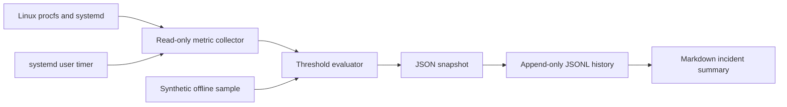

# Architecture

**Security boundary:** The live collector reads `/proc`, uses Python filesystem APIs and optionally asks `systemctl` about named services. No shell command is constructed from external input. The program does not install services, change firewall rules or require root. The optional timer must be installed by the operator and runs as that user.

**Metric definitions:** CPU percentage uses the difference between two `/proc/stat` aggregate CPU readings. Memory usage derives from `MemAvailable`. Disk usage reflects the configured filesystem path. Load averages are 1/5/15-minute system load values, not CPU percentages. Network counters are cumulative byte totals (excluding loopback) and should not be interpreted as instantaneous throughput.

**Snapshot fields:** `schema_version`, `collected_at_utc`, `source`, `hostname`, `overall_status`, `metrics`, `alerts`.

**Reporting:** Each history record contributes one observation. An alert observed in consecutive samples is counted multiple times; count is not unique incident count. No automated root-cause inference is performed.
